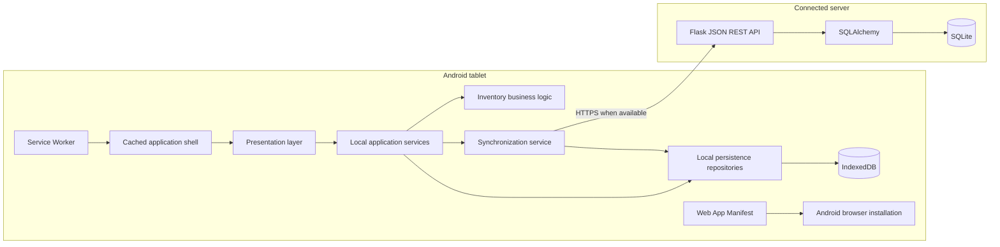
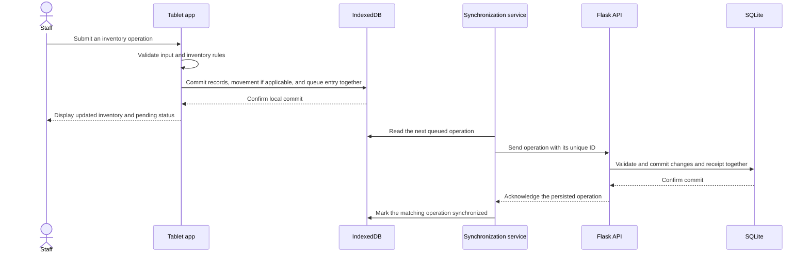
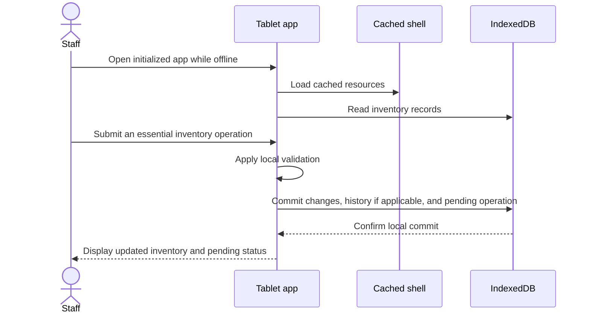

# System Architecture

## 1. Architecture Overview

The confirmed direction is a local-first, tablet-first application for one Android tablet. Develop it as a website first, then add and test offline operation and installation as a Progressive Web Application (PWA). Capacitor-based Android APK packaging is optional.

The tablet is the primary device for daily inventory work. It validates and commits essential operations locally, even during an internet outage. The server revalidates and stores synchronized changes and supports backup and recovery. The module layout, synchronization protocol, and recovery procedures below are technical proposals. Business rules still awaiting confirmation are recorded in the [requirements](REQUIREMENTS.md).

## 2. Technology Stack

| Area | Technology | Role in the project |
|---|---|---|
| Frontend | HTML5 | Defines semantic pages, forms, and controls for the tablet interface. |
| Frontend | CSS3 | Controls responsive layouts, spacing, and touch target sizing. |
| Frontend | Vanilla JavaScript | Handles interactions, local inventory rules, and asynchronous browser storage without adding a frontend framework. |
| Frontend | Bootstrap 5 | Provides reusable layout and interface patterns that the team can adapt for touch. Bundle essential files locally. |
| Frontend | Vite | Runs the existing frontend development server and bundles assets for deployment. |
| Frontend | Inter and Lucide | Provide the approved typography and icons for the Modern Café interface. Bundle essential assets locally. |
| Backend | Python 3 | Implements server-side rules and synchronization services in readable modules. |
| Backend | Flask | Routes connected requests to validation, synchronization, and database services. |
| Backend | JSON REST API | Exchanges structured requests and responses between the tablet and Flask. Endpoint definitions are deferred to the API contract. |
| Backend | SQLAlchemy | Maps Python models to SQLite tables and coordinates database transactions. |
| Persistence | IndexedDB | Stores structured operational records and queued changes on the tablet and supports atomic writes across object stores. |
| Persistence | SQLite | Stores synchronized records, constraints, and processed operation identifiers in a relational database suitable for this initial single-device scope. |
| Offline | Service Worker | Caches the application shell and essential assets so an initialized app can open offline. |
| Offline | Web App Manifest | Supplies installation metadata such as app name, icons, and launch settings. |
| Offline | Local business logic and persistent queue | Validate and save essential changes immediately, then retain them for later synchronization. |
| Development | Visual Studio Code, Git, GitHub | Provide the development editor, local version history, and shared repository for review and collaboration, respectively. |
| Optional packaging | Capacitor, Android Studio | Capacitor can package the web app in an Android shell. Android Studio supports building and testing the optional APK. |

## 3. Architecture Diagram



The business logic determines whether an action is valid. Application services use the persistence layer to read records and commit valid changes. The Service Worker caches files that let the app start offline. IndexedDB stores the actual inventory records, movement history, and synchronization queue. The manifest supports installation metadata.

## 4. Application Layers

| Layer | Responsibilities |
|---|---|
| Presentation | Renders the dashboard, inventory pages, forms, navigation, alerts, and reports. Displays committed balances and synchronization states. |
| Application services | Coordinates actions from the interface, invokes inventory rules, and coordinates local persistence and synchronization. |
| Business logic | Validates inventory inputs and implements duplicate detection, stock calculations, search, sorting, low-stock classification, and expiration classification. Shares rule definitions and test examples with the backend. |
| Local persistence | Provides IndexedDB repositories, atomic transactions, history queries, and durable queue storage. Reads current quantities and performs dependent writes in the same transaction. |
| Backend | Provides Flask routes, server-side validation, database services, ordered synchronization processing, and backup and restoration support. |

Keep UI rendering, inventory calculations, and storage access in separate modules so the same inventory rules can be tested independently of the interface.

## 5. Proposed Project Structure

```text
frontend/
  index.html                Existing Vite entry page
  package.json              Existing Vite scripts
  public/                   Manifest, icons, and other static PWA resources
  src/
    main.js                 Existing JavaScript entry point
    views/                  Dashboard, inventory, and reports
    components/             Reusable forms, alerts, and navigation
    styles/                 Layout and component styles
    domain/                 Inventory rules and algorithms
    services/               Application actions
    db/                     IndexedDB repositories and migrations
    api/                    JSON API client
    sync/                   Queue coordination and retries
    pwa/                    Service Worker source and registration
    mocks/                  Fictional development data
  tests/
backend/
  app/
    routes/                 Flask API routes
    models/                 SQLAlchemy models
    services/               Server-side inventory and recovery logic
    validation/             Request and business-rule validation
    sync/                   Operation processing and receipt handling
    config/                 Environment-based configuration
  tests/
```

Keep the current Vite entry points and introduce folders as features are implemented. Place the built Service Worker within the scope needed to control the deployed app. This tree documents future locations.

## 6. Online and Offline Workflows

### Online



The tablet saves the operation first, even when online. Invalid input or an aborted write leaves the previous balance and history intact. The interface displays success after the local commit. Synchronization status changes only after the server confirms its own commit.

### Offline



Initial setup requires connectivity to download app resources and initialize the first dataset. After initialization, essential inventory tasks use the cached resources and local data without calling Flask. The queue resumes when the app can reach the server.

## 7. Proposed Synchronization Strategy

Use a persistent queue for category and item changes and stock movements, including batch changes attached to a movement. Each operation includes a unique ID, type, related entity ID, validated payload, creation timestamp, local sequence, status, attempt count, last attempt time, and error details when applicable. A movement ID identifies a history entry, while an operation ID identifies a command sent to the server.

1. Assign the next local sequence as part of the same transaction that saves the inventory changes and queue entry. Sequence orders commands even if the tablet clock changes.
2. Use one active queue drain and send operations one at a time in sequence. This keeps a new category ahead of its items and an item ahead of its first stock movement. Resume after restart, on app open or connectivity recovery, and from a manual sync control. Background synchronization is optional.
3. For a new operation, Flask revalidates the payload and applies changes and the processed-operation receipt in one SQLite transaction. A success acknowledgment identifies the operation and is sent after the commit.
4. After a timeout or disconnect, retain the operation and retry with the same ID and payload. If the server already committed, it returns the prior result and skips the inventory update. Reuse of the ID with a different payload is rejected.
5. Distinguish temporary transport failures from server validation failures. Keep retryable work pending with attempt details. Retain rejected operations as failed, show the reason to authorized staff, and stop processing later operations until the failed entry is resolved. Use an approved reconciliation procedure that preserves local history and explicitly accounts for subsequent dependent changes. Never rewrite the payload of an operation that may have reached the server.

The [database design](DATABASE_DESIGN.md) defines queue fields, state transitions, and commit boundaries.

### Exclusive synchronization on the tablet

An installed PWA and a browser tab can share the same tablet and storage. The proposal is one exclusive, origin-scoped Web Lock for the queue drain, with feature detection and a physical test on the intended Android browser and installed PWA. A context acquires the lock before reading the first sendable entry, rechecks the queue and recovery state under the lock, and sends one request at a time. Wait for the acknowledgment and commit its state locally before advancing. If another context holds the lock, show that sync is already running. Release ownership when the drain finishes, fails, times out, or is cancelled. After a closed context or restart, the next holder reads durable queue state and retries an unacknowledged request using its original ID and payload. Use a bounded network timeout and never intentionally steal a lock. A timed-out request may still finish on the server, so the next attempt keeps the original ID and the server serializes writes. [Web Locks API working draft](https://www.w3.org/TR/web-locks/)

If the browser cannot provide reliable exclusive ownership across its installed and browser contexts, keep local work and the queue available and pause upload, including manual upload, until a supported environment or a separately verified coordination method is available. Avoid in-memory flags and timeout-only leases as proof of exclusivity. Keep IndexedDB transactions short, reread affected balances within the write transaction, and perform network work outside it. On SQLite, serialize write validation and mutation, commit the command and unique receipt together, and re-read current state after rollback or contention before retrying. A busy database may return a retryable failure without acknowledging the command.

### Supervised rejection repair

Use independent delivery and resolution fields. Delivery states are `pending`, `failed`, and `synchronized`. Resolution begins at `none`. A definitive server rejection sets delivery to `failed` and resolution to `needs_review`. Temporary network or server failures remain `pending / none`. Later potentially affected commands stay pending and show **Blocked** as a derived indicator. Preserve the original ID, payload, error, and local movements.

1. Stop the drain at the blocker. Review affected records and the later queue suffix against a verified server snapshot and individual receipt results. Protect local data and pause the drain and local inventory writes for the reviewed reconciliation. Keep read access available. An uncertain delivery remains unresolved until receipt status is verified.
2. Stage an effective local inventory projection from verified server records and retained, revalidated local commands. Preserve original local history and show which movements are superseded or closed in the repair audit. Approval records the affected IDs, evidence, reason, authorized reviewer, time, and any replacement link. Exact reviewer authorization remains pending.
3. A reviewed correction keeps the original delivery record and sets resolution to `resolved_replaced`. Submit the corrected command as `pending / none` with a new ID. An approved closure without replacement uses `resolved_closed` and records why. Revalidate dependents and, where required to preserve order, stage the never-sent suffix again in dependency order with fresh sequence numbers. Preserve replaced entries and their links, and verify receipt status before changing any command that might have been sent.
4. Commit the approved local projection, resolution audit, and revised queue together. Skip resolved entries in drains while retaining them for audit. Resume only after checks show that no unresolved blocker remains and the revised dependencies and balances agree. This procedure uses neither an unattended rollback nor destructive editing of historical stock entries.

## 8. Offline PWA Strategy

- Define a manifest with installation metadata and register the Service Worker under the app’s deployment scope. Cache the shell, scripts, styles, icons, and other assets needed to start and operate offline, including locally bundled Bootstrap assets.
- Store inventory data in IndexedDB and show when an operation is local, pending sync, synchronized, or failed. Treat browser connectivity events as retry signals. A server response confirms actual reachability and save results.
- Version app caches and stage updates so a new shell is ready before activation. Coordinate updates with IndexedDB migrations, preserve queued work, and prompt for a reload at a safe point. Keep inventory records and pending operations independent of cache cleanup.
- Use HTTPS for deployment. Localhost on the development computer can support development-time Service Worker testing. A tablet opening that computer’s LAN address needs an appropriate HTTPS test or deployment origin. Browser storage is origin-specific, so the tablet must initialize on the origin it will actually use.
- Verify installation on the actual Android tablet and test offline launch, reads, edits, restarts, and updates separately. Installation alone does not establish that resources or inventory data have been initialized.

### Versioned expiration settings

An approved server administrator provisions a versioned expiration settings record. The tablet receives it in the authorized snapshot at initialization and retains the last approved version in IndexedDB. A connected response can announce a newer settings version. Retrieve and validate the settings from the snapshot and update only that local record in ordinary connected use. If protection or validation prevents refresh, continue using the last verified version and show that a newer version is unavailable locally. Sync does not replace local operational records. A complete settings editor can follow initial provisioning.

Use the same timezone, warning period, and date classification in JavaScript and Python. Asia/Manila is proposed pending confirmation. An unset warning period leaves already expired batches visible and upcoming alerts unavailable. Calendar purchase and expiry dates use the business timezone. Event timestamps use UTC. The alert period and administrative authorization remain open.

## 9. Security and Data Integrity

Validate input locally and revalidate on the server. Use unique identifiers, atomic stock updates, and append-only movement history with corrective entries. Apply approved administrative permissions on the server and define the corresponding local access policy before implementing authentication. Protect server credentials outside source control, use HTTPS, and store password hashes separately from ordinary inventory data if password authentication is approved. Restrict access to backup and restore functions and artifacts. Staff roles, deletion privileges, and the method for offline access remain unresolved.

## 10. Backup and Recovery

Synchronization sends accepted changes to the server. A backup preserves a recoverable copy from a known point in time, including the processed-operation receipts needed to recognize retries. Server synchronization alone does not protect against accidental deletion or loss of server data.

- Create protected, consistent server snapshots with metadata such as timestamp, schema version, and integrity verification. Define retention, ownership, export controls, and storage location before deployment.
- Verify restoration in an isolated environment. Check item balances, movements, allocations, and processed-operation receipts together. Display the last successful backup and synchronization information from confirmed results.
- For a lost, reset, or replaced tablet, recover the approved server dataset over a trusted connection and initialize the replacement under the deployed origin. Browser storage can be cleared or lost. Changes that reached neither the server nor a protected export may be unrecoverable.
- Before restoring onto a tablet with existing data, inspect and protect pending operations. Warn about affected records and follow an approved recovery procedure before replacing local data. If a server rollback predates acknowledged operations, reconcile those acknowledgments against restored receipts and recoverable records before resuming synchronization.

### Recovery after a server restore

Give each server data generation a distinct identifier. A controlled restore rotates it before inventory writes are reopened. Keep the generation outside the restored backup or generate a new value as a required post-restore step. The tablet stores the last verified generation. A mismatch on connection or write preflight pauses normal sync before any queued mutation can run.

An authorized reviewer compares requested operation receipts individually against the restored server, retaining all pending operations and acknowledged command information for the agreed recovery period. A receipt absent from an older generation identifies work requiring review, including previously acknowledged operations that may have been lost from that server. A latest-sync timestamp cannot answer this question. Verify balances, batch allocations, and movement history before authorizing any replay or reconciliation. Preserve pending and newer local data, and record each decision. Resume only after the approved repair and verification are complete and the tablet has recorded the accepted new generation. Never replay missing operations or install an older snapshot automatically. Transactions that were neither synchronized nor backed up may be unrecoverable after device loss.

## 11. System Constraints and Open Decisions

One Android tablet is the initial operating device. Internet can be unavailable during work. Simultaneous multi-device editing and direct Loyverse integration are outside the initial scope. Inventory comes before sales and orders, and replacing Loyverse remains a separate business decision.

See [Open Decisions](OPEN_DECISIONS.md). Confirm the actual tablet and browser, the HTTPS deployment and hosting arrangement, offline access and staff permissions, outage expectations, and backup frequency, retention, and ownership. Frontend work centers on touch-friendly offline workflows and reliable local commits. Backend work centers on equivalent validation, transactional persistence, duplicate-safe synchronization, and tested recovery.
