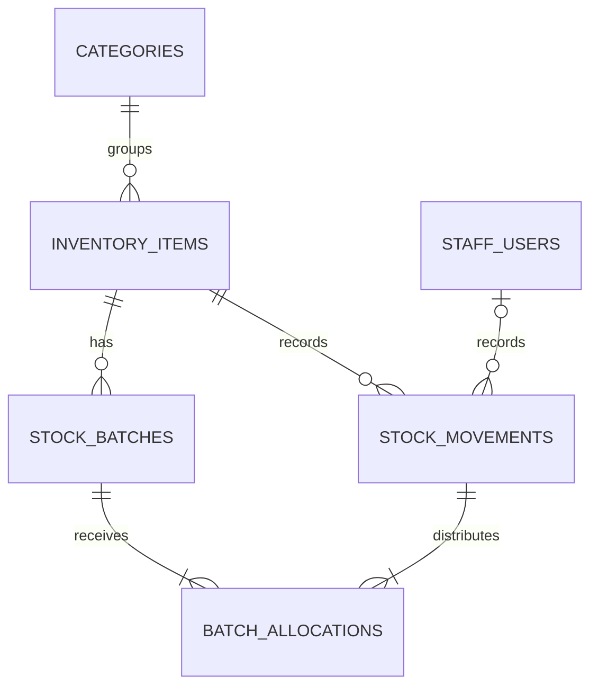

# Database Design

## 1. Database Design Overview

The confirmed architecture uses IndexedDB for operational records on the tablet and SQLite for synchronized server records. Both share entity identifiers, quantity conventions, and validation rules. IndexedDB uses keyed object stores. SQLite uses relational tables and constraints. The schemas and algorithms below are proposals based on the [requirements](REQUIREMENTS.md) and [architecture](ARCHITECTURE.md).

Use locally generated UUIDs for entity and operation identifiers so new records can be created offline. An operation ID identifies a synchronization request, while a movement ID identifies a stock history record. Use the same values when records are synchronized. In the field tables, **PK** means primary key and **FK** means foreign key. A dash in the Default column means the value is supplied or set by the application rather than assumed.

## 2. Proposed Core Entities

### 2.1 Categories

| Field | Type / key | Required | Default | Validation and purpose |
|---|---|---|---|---|
| category_id | UUID, PK | Yes | Generated UUID | Stable identifier. |
| name | Text | Yes | — | Nonblank display name after trimming. |
| normalized_name | Text | Yes | Derived from name | Nonblank canonical name. Enforce uniqueness under the agreed category name and archival rules. |
| description | Text | No | null | Optional category description. |
| is_active | Boolean | Yes | true | Indicates whether the category is active. Archive with an update and preserve references from items. |
| created_at | UTC timestamp | Yes | Creation time | Valid timestamp for creation. |
| updated_at | UTC timestamp | Yes | Creation time | Set on update. Preserve the original creation time. |

### 2.2 InventoryItems

| Field | Type / key | Required | Default | Validation and purpose |
|---|---|---|---|---|
| item_id | UUID, PK | Yes | Generated UUID | Stable identifier for a distinct inventory item. |
| category_id | UUID, FK → Categories | Yes | — | References an existing category. New assignments must use a category eligible under the agreed rules. |
| name | Text | Yes | — | Nonblank display name after trimming. |
| normalized_name | Text | Yes | Derived from name | Used to find potential duplicates. A matching name alone does not establish identity. |
| unit_of_measurement | Text | Yes | — | Stable unit identifier referring to an immutable quantity profile. Lock unit and scale after any batch or movement exists. An approved migration must preserve original history and the meaning of pending commands. |
| minimum_stock_level | Scaled integer | Yes | — | Nonnegative, in the item's agreed unit and scale. Use a configured value. |
| is_active | Boolean | Yes | true | Lets staff archive the item while retaining references and history. |
| created_at | UTC timestamp | Yes | Creation time | Valid creation timestamp. |
| updated_at | UTC timestamp | Yes | Creation time | Set when item information changes. |

Available quantity is derived from signed stock movements. A materialized balance is optional for efficient display. If added, it must be updated atomically with the movement and be rebuildable from history. Purchase price, purchase date, and expiration date are batch or purchase information.

### 2.3 StockBatches

| Field | Type / key | Required | Default | Validation and purpose |
|---|---|---|---|---|
| batch_id | UUID, PK | Yes | Generated UUID | Identifies one delivery or tracked lot. |
| item_id | UUID, FK → InventoryItems | Yes | — | Existing item whose measure applies to the batch. |
| received_quantity | Scaled integer | Yes | — | Positive opening or received quantity, linked to its originating movement and allocation. Record later corrections in history. |
| purchase_date | Calendar date | No | null | Valid known purchase date. Leave unknown dates unset for opening stock. |
| purchase_cost | Integer centavos | No | null | Nonnegative if known. Whether the amount describes one unit or the whole batch remains pending. |
| expiration_date | Calendar date | No | null | Optional valid date. If both dates are known, the proposed validation flags an expiration date earlier than the purchase date for review under agreed handling rules. |
| created_at | UTC timestamp | Yes | Creation time | Valid timestamp for creating the batch record. |

Remaining quantity is the sum of signed allocations for the batch, including its opening or receiving allocation. A cached quantity, if added, must match that sum. Receiving more stock for an existing item creates a delivery record and movement associated with the same item.

### 2.4 StockMovements

| Field | Type / key | Required | Default | Validation and purpose |
|---|---|---|---|---|
| movement_id | UUID, PK | Yes | Generated UUID | Identifies a single immutable stock event. |
| item_id | UUID, FK → InventoryItems | Yes | — | Existing item affected by the event. |
| movement_type | Enum | Yes | — | One of initial stock, stock-in, stock-out, wastage, positive adjustment, or negative adjustment. |
| quantity_change | Signed scaled integer | Yes | — | Nonzero and in the item’s scale. Positive for initial stock, stock-in, and positive adjustments. Negative for stock-out, wastage, and negative adjustments. |
| reason | Text | Conditional | null | Nonblank when required by the agreed rules. Proposed for adjustments and wastage so corrections are explainable. |
| recorded_by | UUID, FK → StaffUsers | Conditional | null | Staff identifier when attribution is implemented and required. |
| created_at | UTC timestamp | Yes | Recording time | Timestamp for movement history. Queue sequence governs sync order. |

Enter opening quantities through traceable initial stock movements. An item with no stock starts with a zero derived balance. Record disposal of expired supplies through an appropriate movement. Expiration classification by itself leaves quantity unchanged. Disposal, damaged units, and wastage are recorded through an approved signed movement and retain their reason and allocations. Correct history through additional traceable movements.

### 2.5 BatchAllocations

This supporting entity connects a movement to one or more batches. The proposal allocates every quantity-changing movement across the affected batches, including opening and receiving entries. This keeps the item total and batch totals comparable.

| Field | Type / key | Required | Default | Validation and purpose |
|---|---|---|---|---|
| allocation_id | UUID, PK | Yes | Generated UUID | Identifies one allocation. |
| movement_id | UUID, FK → StockMovements | Yes | — | Links the allocation to its movement. |
| batch_id | UUID, FK → StockBatches | Yes | — | Links the allocation to a batch for the same item as the movement. |
| quantity_change | Signed scaled integer | Yes | — | Nonzero, same sign and units as the parent movement. Allocations sum exactly to the movement’s quantity change. |

Use one allocation per movement and batch pair. Outgoing allocations must respect each batch’s remaining quantity. The batch selection policy is pending. A positive correction may add to an identified batch. Creation of a new correction batch and the meaning of its opening quantity require approved provenance rules before production use.

For the first fictional demonstration, staff explicitly select an eligible batch. FIFO uses earliest receipt first and is simple for stock without meaningful expiry. FEFO uses earliest valid expiration first and can reduce waste for eligible perishable stock. Manual selection handles exceptions and preserves staff control, but needs clear validation. Consider FEFO for eligible perishables and FIFO or manual selection for other stock. Production eligibility, ties, treatment of undated or expired stock, and adjustment provenance remain pending.

### 2.6 StaffUsers

Staff identification is proposed. Roles, permissions, offline access, and authentication behavior remain pending. This entity represents attribution metadata. If authentication is required, store server credentials securely and separately from ordinary inventory records.

| Field | Type / key | Required | Default | Validation and purpose |
|---|---|---|---|---|
| user_id | UUID, PK | Yes | Generated UUID | Stable attribution identifier. |
| display_name | Text | Yes | — | Nonblank staff label. |
| role | Text | Conditional | null | Must be an approved role where role-based access is implemented. |
| is_active | Boolean | Yes | true | Supports deactivating staff while retaining historical attribution. |
| created_at | UTC timestamp | Yes | Creation time | Valid timestamp identifying when the record was created. |

### 2.7 SynchronizationQueue

Local only. The queue persists across restarts and contains category changes, item changes, and movement commands with related batch changes.

| Field | Type / key | Required | Default | Validation and purpose |
|---|---|---|---|---|
| operation_id | UUID, PK | Yes | Generated UUID | Stable across retries. |
| operation_type | Text | Yes | — | Supported command type. Determines payload validation. |
| entity_id | UUID, typed reference | Yes | — | Main related category, item, or movement. Validate against the operation type and payload. |
| payload | Structured object | Yes | — | Validated, JSON-compatible command. Keep the submitted payload stable across retries. |
| wire_version | Integer | Yes | 1 for the slice | Identifies the API version used to send the original command, retained across upgrades. |
| local_sequence | Integer, unique | Yes | Next local sequence | Strictly increasing on the tablet. Allocate atomically with the queued changes. |
| status | Enum | Yes | pending | pending, synchronized, or failed. |
| retry_count | Integer | Yes | 0 | Nonnegative retry count. Increment when retrying. |
| last_attempt_at | UTC timestamp | No | null | Set when attempting delivery. |
| last_error | Structured object | No | null | Sanitized failure code and details suitable for troubleshooting. |
| created_at | UTC timestamp | Yes | Creation time | When the command was saved locally. |
| synchronized_at | UTC timestamp | No | null | Set only after acknowledgment of the matching persisted operation. |
| resolution_status | Enum | Yes | none | none, needs_review, resolved_replaced, or resolved_closed. Kept separate from delivery status. |
| resolution_audit | Structured object | No | null | Reviewed decision with original and replacement IDs where applicable, affected IDs, reason, evidence references, reviewer, and UTC time. Preserve prior audit evidence. |

New operations start `pending / none`. Transient failures keep that state and update retry details. Definitive rejection sets `failed / needs_review`. Blocked dependents retain their delivery state. Under approved reconciliation, a reviewed entry may become `resolved_replaced` or `resolved_closed` without changing its original delivery record. A corrected or restaged command has a fresh ID, sequence, and `pending / none` state. Exclude resolved audit entries from drain and pending counts. Preserve historical quantities and movements in the audit independently of the repaired effective projection. Retain their original payloads, errors, and historical movements. Preserve acknowledged command details for the agreed recovery window and all unresolved pending work. Record audit links when rebuilding the effective inventory projection from verified records and revalidated commands. Commit the projection, resolution audit, and resulting queue changes atomically. See the [supervised repair workflow](ARCHITECTURE.md#supervised-rejection-repair).

### 2.8 ProcessedOperations

Server only. Each committed command has one receipt. A receipt lets a retry recover the original result without applying the same stock movement again.

| Field | Type / key | Required | Default | Validation and purpose |
|---|---|---|---|---|
| operation_id | UUID, PK | Yes | — | Unique tablet command identifier. |
| operation_type | Text | Yes | — | Accepted command type. Must match on replay. |
| request_fingerprint | Text | Yes | Derived from request | Digest of the schema-versioned canonical command as specified in the API contract. Keep its profile version, and compare replays using the same profile so an upgrade does not change receipt meaning. |
| processed_at | UTC timestamp | Yes | Server processing time | Records the accepted operation’s server processing time. |
| processing_result | JSON object | Yes | — | Stores the acknowledgment data needed to return the prior success result. |

### 2.9 ApplicationSettings

Settings may exist locally, on the server, or in both places according to ownership. Local synchronization metadata belongs on the tablet. Server backup metadata belongs on the server and can be displayed on the tablet after confirmation.

| Field | Type / key | Required | Default | Validation and purpose |
|---|---|---|---|---|
| setting_key | Text, PK | Yes | — | Approved key for a known scope, such as expiration warning period, backup configuration, last confirmed sync or backup, or the local queue counter. |
| value | Typed JSON value | Yes | Key-specific | Validate by key. Warning periods must be nonnegative whole days. Store last-success timestamps only after confirmed events. Initialize the internal sequence counter at zero for an empty database. |
| updated_at | UTC timestamp | Yes | Write time | Tracks the setting’s most recent update. |

Use a versioned server-owned expiration settings record containing `settings_version`, `business_timezone`, and nullable `expiration_warning_days`. The authorized snapshot supplies the initial record and approved refreshes. The tablet keeps the last verified version offline. Server generation metadata is rotated on restore and must not be recovered unchanged from the older backup. Store the last verified generation locally. Business defaults, including Asia/Manila as the proposed timezone, remain pending. Leave unavailable backup and synchronization information unset until the first confirmed success. Store credentials outside this entity.

## 3. Entity Relationship Diagram



A category can group many items, and every item belongs to one category. An item can have many batches and movements. Each movement and batch has at least one allocation under the proposed all-movements allocation rule, and each allocation links one movement to one batch of the same item. This lets a stock-out use more than one delivery. A staff member can be attributed to many movements, while a movement can have zero or one recorded staff member. SynchronizationQueue and ProcessedOperations share an operation ID across separate databases. ApplicationSettings belongs to the applicable store and has no inventory foreign key.

## 4. Constraints and Transaction Rules

- Require primary keys, valid foreign keys, nonblank names, unique operation IDs, and nonnegative minimum stock levels. Use agreed normalized category uniqueness. Index item names for duplicate warnings and enforce item uniqueness only according to approved rules.
- Store quantities as scaled integers. Each stable unit ID maps to an immutable scale, and any later incompatible profile needs a new ID. Parse a decimal input from text with integer arithmetic by applying the scale and padding fractional digits exactly. Reject excess fractional precision rather than rounding silently, including any unit conversion without an approved exact rule. Validate canonical JSON integer tokens and reject fractions, exponent notation, booleans, and strings at the wire boundary for integer fields. Keep values and all intermediate results within −9,007,199,254,740,991 to +9,007,199,254,740,991, with stricter nonnegative or signed constraints by field. Store Philippine peso amounts in integer centavos. Confirm production unit profiles and whether purchase cost describes a unit or batch before accepting real prices.
- Store purchase and expiration dates as calendar dates, represented as ISO date strings locally and DATE values through SQLAlchemy. Store event timestamps in UTC. Agree on the business timezone for interpreting calendar boundaries.
- Validate sign, nonzero quantity, batch ownership, exact allocation totals, and nonnegative resulting item and batch balances by default. Read current data and validate changes inside the write transaction. Enforce multi-record invariants in the application services on both sides.
- In one local transaction, write the item or cache changes as needed, batch changes, movement, allocations, queue sequence, and queued operation. A failed write rolls back all parts. Keep local reads and writes within the short IndexedDB transaction and send network requests after it completes. On the server, serialize validation against current state and persist the accepted changes and receipt in one transaction.
- Keep references valid through archival of items, categories, and staff. Preserve historical stock and allocation records. Quantity corrections use movements. Expired quantities stay in the balance until recorded use, disposal, or correction.

## 5. Data Structures and Algorithms

Complexities below describe the proposed in-memory algorithms unless an indexed lookup is stated. Let **n** be items, **m** movements, **b** batches, **a** allocations, and **q** queued operations considered. Course exercises can demonstrate scans and sorting on arrays. Production queries should use primary keys and indexes where the access pattern benefits, and no particular sorting algorithm is assumed.

### A. Search

**Inputs and outputs.** An item ID or name query returns one item, no match, or a matching list. This helps staff locate existing supplies before creating new records.

```text
findById(id):
    return itemStore.get(id)

findByName(query, items):
    term = normalize(query)
    return items whose normalized_name contains term
```

A primary-key index avoids a full scan and a tree-backed lookup is typically O(log n). A substring scan examines O(n) records plus string comparison costs. A normalized-name index can support exact lookups and suitable prefix searches.

### B. Sorting and Grouping

**Inputs and outputs.** Item records and a selected sort mode produce an ordered list or category groups. This supports browsing and prioritizes restocking.

```text
sortInventory(items, mode):
    if mode is name: sort by normalized name, then ID
    if mode is quantity: group by unit ID, sort within each group by decoded quantity, normalized name, then ID
    if mode is category: group by category ID, then order labels and items by name
    if mode is restocking:
        select out-of-stock and low-stock items
        sort out-of-stock before low-stock, then by name and ID
```

A comparison sort can run in O(n log n), with hash grouping typically O(n) before ordering. Prepare balances once so each comparison can read a value directly. The restocking order shown is a proposal and avoids comparing quantities across unlike units.

### C. Duplicate Detection

**Inputs and outputs.** A draft item and existing records produce potential matches and a warning. Staff can distinguish creating a new item from receiving stock for an existing item.

```text
normalize(name):
    normalize to NFC; trim and collapse whitespace using the pinned Unicode White_Space data
    apply the pinned Unicode default full case fold and normalize to NFC again
    return the canonical name

detectDuplicates(draft):
    candidates = lookup items by normalize(draft.name)
    compare candidate category, unit, and other agreed distinguishing attributes
    if likely matches exist: warn before save and offer existing item for stock-in
    apply agreed uniqueness rules without automatically merging records
```

Pin the same released Unicode data version on both sides. Compare normalized strings by Unicode code point and use stable UUID text as the final sort tie-breaker. A normalized match is a warning candidate until agreed category, unit, and identity rules establish a uniqueness conflict. A scan is O(n) record comparisons plus text processing. A tree-index lookup is typically O(log n + k) for k matches, followed by comparisons of those candidates.

### D. Stock Calculation

**Inputs and outputs.** Signed movements for an item produce its available balance. Signed allocations for a batch produce its remaining balance. Each can be rebuilt to audit cached quantities.

Available stock = initial stock + received stock − used stock − wastage + net signed adjustments.

```text
itemBalance(itemId):
    return sum(quantity_change for movements matching itemId, starting at 0)

batchBalance(batchId):
    return sum(quantity_change for allocations matching batchId, starting at 0)

validateMovement(item, movement, allocations):
    require allocation quantities sum to movement.quantity_change
    require all affected batches belong to item
    require resulting item and batch balances are valid
```

Summing matching movements or allocations is linear in the number of matching records after retrieval. Use the signs already recorded when summing. A cached balance is efficient to read and must be updated with the same transaction.

### E. Low-Stock Classification

**Inputs and outputs.** An available balance and configured minimum yield out of stock, low stock, or sufficient. The result feeds alerts and restocking views.

```text
classifyStock(balance, minimum):
    if balance == 0: return out of stock
    if 0 < balance <= minimum: return low stock
    return sufficient
```

This takes O(1) per item after validating the balance and threshold, and O(n) for a list. Low stock and out of stock are counted separately.

### F. Expiration Classification

**Inputs and outputs.** A batch’s remaining amount, optional expiration date, business date, and configured warning period yield its alert state. Evaluate batches with positive remaining stock only.

```text
classifyExpiration(batch, today, warningDays):
    if batch.remaining == 0: skip this batch for alerts
    if batch.expiration_date is missing: return no expiration date
    if batch.expiration_date < today: return expired
    if warningDays is unset: return warning period not configured
    if batch.expiration_date <= today plus warningDays: return expiring soon
    return not expiring soon
```

Proposed boundary rule pending approval. A batch dated today is expiring soon and becomes expired the next business calendar day. The final warning day is inclusive. Use the café’s agreed timezone and calendar-day arithmetic. This takes O(1) per batch or O(b) for all batches after balances are available.

### G. Synchronization Queue

**Inputs and outputs.** Queued commands and server responses produce acknowledged, pending, or failed states. Stable IDs make retries safe after interrupted delivery.

```text
drainQueue():
    hold the exclusive origin-scoped drain lock and verify the server generation
    for operation in unresolved queue entries ordered by local_sequence:
        if operation needs review or is blocked by recovery: stop for reconciliation
        response = send original operation
        if matching persisted success: record synchronized
        else if definitive rejection: record failed and stop
        else: record retry details, keep pending, and stop

processOnServer(operation):
    in one serialized SQLite write transaction:
        verify that normal writes are enabled and the expected generation matches
        if receipt exists:
            validate that operation matches receipt fingerprint
            use stored success result without a new stock change
        else:
            validate and apply operation
            insert receipt under unique operation ID
    return success only after transaction commits
```

An ordered index supports scanning up to q entries in O(q) after positioning, excluding network calls and the work of each command. Without an ordered index, sorting a snapshot could take O(q log q). Handle a concurrent delivery of the same ID by rolling back any losing transaction, rereading the committed receipt, and verifying that the request matches.

### H. Aggregation

**Inputs and outputs.** Inventory items, movements, batches, allocations, and report filters produce item counts, status counts, and movement totals. These drive the dashboard and reports from stored data.

```text
buildReport(items, movements, batches, allocations, dateRange):
    build current item balances by summing all movements by item ID
    build current batch balances by summing all allocations by batch ID
    count active items by stock status using current balances
    count distinct active item IDs with eligible expiring-soon batches
    sum date-filtered movements by item, unit, and movement type
    return counts, balances, and grouped movement totals
```

Use a separate report date filter for movement totals, so past movements still contribute to current stock. Keep different units separate and show an unavailable expiration indicator when applicable records are absent. Hash-map aggregation over these inputs takes expected O(n + m + b + a). SQLite can process grouped reports using indexed filters and SQL aggregation when practical.

## 6. Proposed IndexedDB Design

| Object store | Key path | Proposed indexes |
|---|---|---|
| categories | category_id | normalized_name, with uniqueness under the approved rule |
| inventory_items | item_id | normalized_name, category_id |
| stock_batches | batch_id | item_id, expiration_date |
| stock_movements | movement_id | item_id + created_at, movement_type + created_at, created_at |
| batch_allocations | allocation_id | movement_id, batch_id, unique movement_id + batch_id |
| staff_users | user_id | Optional display_name lookup where attribution is implemented |
| synchronization_queue | operation_id | Unique local_sequence, status + local_sequence |
| application_settings | setting_key | Primary key lookup |

An object store holds JavaScript records keyed by a field. The repositories and application services enforce relationships because IndexedDB has no SQL foreign-key enforcement. For synchronization, scan in sequence across pending and failed entries, skipping synchronized entries while maintaining the first unresolved dependency. In a stock write, use one read-write transaction covering the relevant stores, including the local queue and sequence. Acknowledge the UI on transaction completion.

Use explicit schema versions and transactional upgrades for changes to stores or indexes. Check upgrade behavior with saved records and pending operations. Preserve IDs, allocations, history, and queued payloads. Coordinate old tabs and app-shell updates so stale code does not write against a new schema. Keep the queued payload readable across upgrades or migrate it through an approved compatibility procedure that preserves retry identity.

## 7. Proposed SQLite Design

Use SQLAlchemy models for tables named categories, inventory_items, stock_batches, stock_movements, batch_allocations, staff_users where attribution is implemented, processed_operations, and application_settings for server-owned values. SQLite has no tablet queue table. Model the one-to-many relationships in the ERD and use explicit FK constraints with restrictive deletion for referenced records. Enable SQLite foreign-key enforcement for every database connection. Use indexed foreign keys and the equivalent server indexes for normalized names, expiration lookups, movement history, and allocation pairs. Use UNIQUE constraints for approved category uniqueness and allocation pairs. Processed operation IDs are unique through the primary key.

Keep same-item and aggregate balance checks within the server transaction. Where useful, use row-level checks for supported movement types, signed quantities and nonnegative values. Confirm the aggregate exactly before committing and keep inventory mutations and the processed-operation receipt together. Version the schema and verify proposed migrations with existing data and restored snapshots. Back up before migrating and verify constraints, balances, and replayed operation receipts afterward.

## 8. Illustrative Sample Data

All identifiers, categories, dates, quantities, units, and thresholds in this example are fictional and use short labels in place of UUIDs. The examples leave purchase cost unspecified while the pricing basis is pending.

| Category | Example items |
|---|---|
| Ingredients | Coffee beans, milk, chocolate syrup |
| Packaging | Paper cups |

| Item | Batch | Example purchase date | Example expiration | Received quantity |
|---|---|---|---|---|
| Coffee beans | B1 | 2026-11-10 | — | 1,000 g |
| Coffee beans | B2 | 2026-11-14 | — | 500 g |
| Milk | B3 | 2026-11-16 | 2026-11-20 | 3,000 mL |
| Chocolate syrup | B4 | 2026-11-17 | 2027-02-01 | 750 mL |
| Paper cups | B5 | 2026-11-16 | — | 60 pieces |

| Movement | Item | Type | Signed quantity | Batch allocation |
|---|---|---|---:|---|
| M1 | Coffee beans | Initial stock | +1,000 g | B1 +1,000 g |
| M2 | Coffee beans | Stock-in | +500 g | B2 +500 g |
| M3 | Coffee beans | Stock-out | −1,100 g | B1 −1,000 g, B2 −100 g |
| M4 | Milk | Stock-in | +3,000 mL | B3 +3,000 mL |
| M5 | Milk | Wastage | −500 mL | B3 −500 mL |
| M6 | Chocolate syrup | Stock-in | +750 mL | B4 +750 mL |
| M7 | Chocolate syrup | Negative adjustment | −50 mL | B4 −50 mL |
| M8 | Paper cups | Stock-in | +60 pieces | B5 +60 pieces |
| M9 | Paper cups | Stock-out | −60 pieces | B5 −60 pieces |

| Item | Remaining by batch | Available | Fictional minimum | Classification |
|---|---|---|---|---|
| Coffee beans | B1 0 g, B2 400 g | 400 g | 400 g | Low stock |
| Milk | B3 2,500 mL | 2,500 mL | 3,000 mL | Low stock |
| Chocolate syrup | B4 700 mL | 700 mL | 200 mL | Sufficient |
| Paper cups | B5 0 pieces | 0 pieces | 15 pieces | Out of stock |

The example coffee withdrawal shows a single movement allocated to two batches. It illustrates the arithmetic without choosing a default batch-depletion rule.

## 9. Conditional Stage 2 Entities

Future extensions may include MenuItems, Orders, OrderItems, and SalesTransactions after Stage 2 approval. RecipeIngredients is conditional on confirmed ingredient quantities, units, and deduction rules. None of these entities is required for the inventory MVP.

## 10. Unresolved Decisions

See [Open Decisions](OPEN_DECISIONS.md) for confirmation owners and gates.

- Confirm actual categories, inventory records and item count, units, quantity precision and conversions, minimum levels, duplicate identity rules, and purchase cost basis.
- Confirm how to handle expired, damaged, or wasted stock and how to select batches. Evaluate FIFO (first received, first used), FEFO (earliest expiration, first used), or manual batch selection with the café. Confirm the business timezone, expiration date boundaries, and warning period.
- Confirm staff permissions, attribution requirements, authentication and offline access, backup cadence and retention, archive policy, and ownership of hosting and recovery.
- Agree on queue repair and receipt retention, payload compatibility after upgrades, and when a cached balance warrants its maintenance cost. Detailed API payloads and endpoints are deferred to the API contract.
